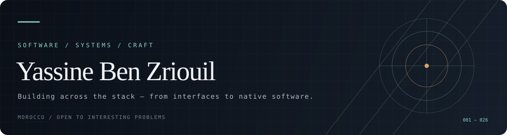

  
   
  <a href="https://ybz.vercel.app">Portfolio</a> &nbsp;·&nbsp;
  <a href="https://github.com/YassineBenZriouil">GitHub</a>

 

## A little about how I build

I'm a software developer interested in how software works at every layer — from the interface people touch to the systems underneath it.

I started with web and mobile development, but the projects I enjoy most increasingly move closer to the machine: native desktop applications, media pipelines, local-first tools, and experiments with Rust and C++.

I like software that feels considered: responsive, useful, technically honest, and built with care.

---

## Selected work

<table>
  <tr>
    <td width="50%" valign="top">
      <strong><a href="https://github.com/YassineBenZriouil/DRASIL">DRASIL</a></strong> 
      FILESYSTEM · DESKTOP · RUST
      
A private, offline file manager that turns a filesystem into an explorable radial world. Built around the idea that managing files should feel visual, not administrative.

    </td>
    <td width="50%" valign="top">
      <strong><a href="https://github.com/YassineBenZriouil/Y-Player">Y-Player</a></strong> 
      MEDIA · NATIVE WINDOWS · C++
      
A hardware-accelerated video player focused on playback performance, deep controls, and a native Windows experience.

    </td>
  </tr>
  <tr>
    <td width="50%" valign="top">
      <strong><a href="https://github.com/YassineBenZriouil/Atlas">ATLAS</a></strong> 
      WINDOWS · AUTOMATION · PYTHON
      
A local voice-controlled assistant that translates speech into validated commands and native Windows actions — without an LLM or cloud dependency.

    </td>
    <td width="50%" valign="top">
      <strong><a href="https://github.com/YassineBenZriouil/Spendly">Spendly</a></strong> 
      MOBILE · PRIVACY · REACT NATIVE
      
An offline-first expense tracker designed around one quick interaction: choose a category, set the amount, save. No account and no tracking.

    </td>
  </tr>
  <tr>
    <td width="50%" valign="top">
      <strong><a href="https://github.com/YassineBenZriouil/Pulse">Pulse</a></strong> 
      AUDIO · VISUALIZATION · WEB
      
A browser-based audio visualization studio with real-time FFT analysis, interchangeable visual engines, presets, and deterministic export.

    </td>
    <td width="50%" valign="top">
      <strong><a href="https://github.com/YassineBenZriouil/Beast-Base">Beast Base</a></strong> 
      DATA · PRODUCT · WEB
      
A project exploring structured data and discovery, with an emphasis on making large collections more useful to explore.

    </td>
  </tr>
</table>

---

## Languages

Languages I've worked with across projects and experiments:

  

**SQL** · querying and working with relational databases

## Tools & ecosystems

| Area | Technologies |
| --- | --- |
| Web | React, Next.js, Node.js, Express, Laravel, Django |
| Mobile | React Native, Expo, Flutter |
| Desktop & native | Rust, C++, Qt, Tauri, Electron |
| Game development | Unity · C#, Godot |
| Data & storage | PostgreSQL, MySQL, SQLite, MongoDB, Firebase |
| Workflow | Git, Docker, Linux, Windows |

---

## What I'm drawn to

- **Systems software** — operating systems, filesystems, processes, and the boundary between software and hardware.
- **Native applications** — software that uses the platform rather than hiding from it.
- **Media & graphics** — rendering, audio, video, visualization, and performance.
- **Developer tools** — small, dependable tools that make complex work easier.

I'm always interested in technically challenging work, especially when there's room to learn deeply and build it properly.

 

  Thanks for stopping by. Have a look through the repositories — the work says more than a list of buzzwords.

